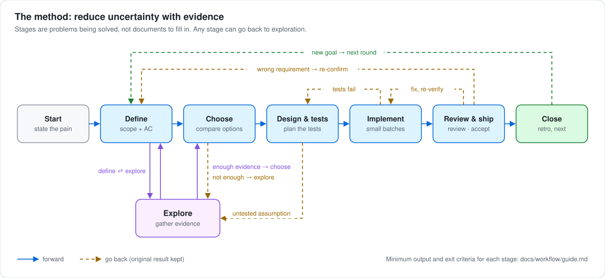
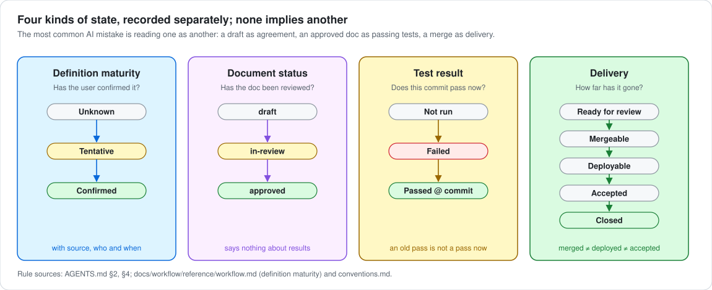
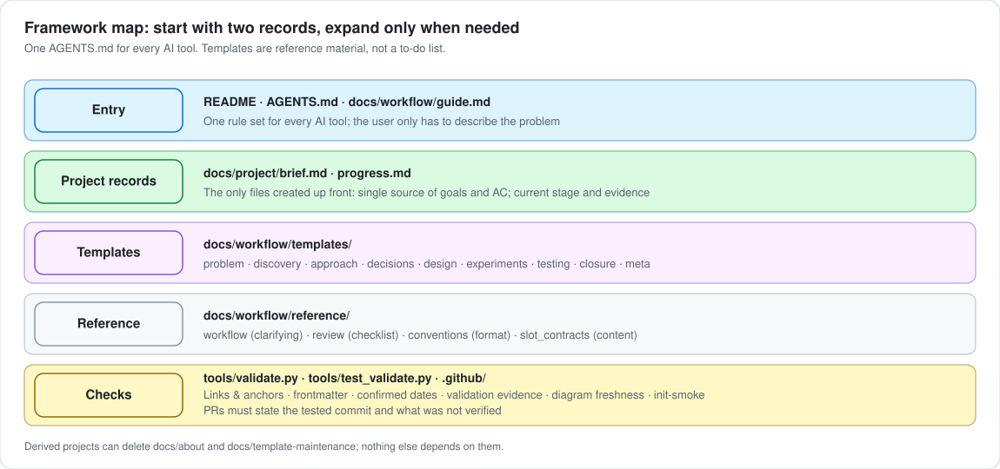
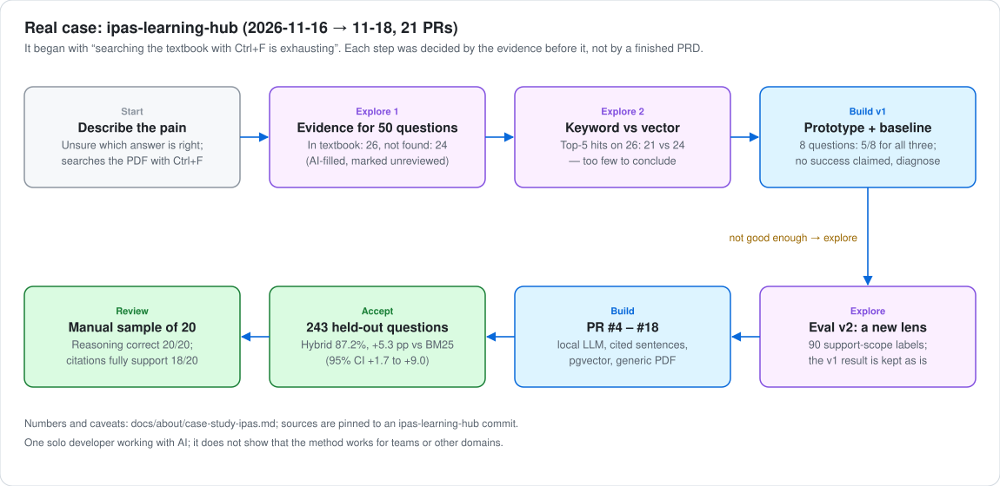

# problem-def-template — start AI work from a vague problem, move forward on evidence

**English** | [繁體中文](README.zh-TW.md)

Describe your problem in one sentence, and an AI agent helps you narrow it down to **confirmed scope, measurable success criteria and traceable verification results**. This is a methodology and document template for AI-assisted development. Every AI tool shares one [AGENTS.md](AGENTS.md), and a project starts with only two records.

The [evidence map](docs/about/EVIDENCE.md) lists each claim, where the rule is written, how it is enforced, and what happened in a real project.

> The rules, guide and templates are written in Traditional Chinese. This README and the diagrams are available in both languages; AI agents read the Chinese rules without trouble.

<picture>
  <source media="(prefers-color-scheme: dark)" srcset="docs/about/assets/method-loop-en-dark.svg">
  
</picture>

## Why it exists

AI agents are productive inside one chat. Across many sessions, and when the request is vague, they fail in predictable ways:

| Common failure in AI-assisted work | What this method does instead |
|---|---|
| A solution the user mentioned in passing becomes a confirmed requirement | Each definition is marked *unknown*, *tentative* or *confirmed*, with source, who confirmed it and when. Silence and AI drafts never count as confirmation |
| With no baseline, the agent writes "accuracy ≥ 90%" anyway | Invented thresholds are not allowed. Measure a baseline first, or use an explicit, repeatable manual criterion |
| When results disappoint, the criteria quietly change so the work "passes" | Changing a confirmed AC requires stating the impact and getting confirmation. The original result is kept, and the work goes back to exploration |
| A finished or approved document is treated as a finished feature | Document status, test results and delivery state are recorded separately |
| A pass from long ago is reported as passing now | Every test result names the commit it ran against. Not run, mocked and failed are written down |
| A new session forgets where the work stopped | progress records the current stage, evidence, unmet exit criteria and the next smallest action, updated at the start and end of every session |
| The agent reviews its own work and calls it reviewed | AI self-review never stands in for independent human approval |

<picture>
  <source media="(prefers-color-scheme: dark)" srcset="docs/about/assets/status-axes-en-dark.svg">
  
</picture>

## What is in the box

<picture>
  <source media="(prefers-color-scheme: dark)" srcset="docs/about/assets/framework-map-en-dark.svg">
  
</picture>

| Layer | Read | Purpose |
|---|---|---|
| **Entry** | [AGENTS.md](AGENTS.md), [guide](docs/workflow/guide.md) | Shared rules for every AI tool; the stage table lists the minimum output and exit criteria for each step |
| **Project records** | [brief](docs/project/brief.md), [progress](docs/project/progress.md) | The only two files created up front: single source of goals and AC; current progress and evidence |
| **Templates** | [template library](docs/workflow/templates/README.md) | PRD, discovery, option comparison, ADR, design, experiments, testing, closure. Copy one only when you need it |
| **Reference** | [workflow](docs/workflow/reference/workflow.md), [review](docs/workflow/reference/review.md), [conventions](docs/workflow/reference/conventions.md), [slot contracts](docs/workflow/reference/slot_contracts.md) | Clarifying process, review checklist, document format, content requirements per document |
| **Checks** | [`tools/validate.py`](tools/validate.py), [PR template](.github/pull_request_template.md) | Links and anchors, frontmatter, a date on every *confirmed* item, required evidence fields in validation records, diagram freshness and CI init-smoke; every PR states the tested commit and what was not verified |

## Real case: ipas-learning-hub

The author used this template to go from one sentence — "I can't tell which answer is right, so I search the textbook with Ctrl+F" — to a local RAG system with source citations, in three days and 21 PRs.

<picture>
  <source media="(prefers-color-scheme: dark)" srcset="docs/about/assets/case-ipas-en-dark.svg">
  
</picture>

| What the method requires | What actually happened |
|---|---|
| No conclusion without a baseline | Explore 2: vector retrieval hit 24 questions, BM25 hit 21. The record says "the sample is too small to conclude" |
| Go back to exploration when results are poor | The prototype scored 5/8 with all three retrieval methods. No success was claimed; the misses were diagnosed, a new evaluation (v2) was built, and the v1 result was kept unchanged |
| Accept on data the system has not seen | 243 held-out exam questions: hybrid retrieval 87.2%, 5.3 points above BM25 (95% CI +1.7 to +9.0) |
| A correct choice is not proof of correct reasoning | Manual sample of 20: reasoning correct 20/20, citations fully supportive 18/20. The record states the reviewer was the author, not an independent third party |

The full story, which templates were actually used and what did not work well is in the [case study](docs/about/case-study-ipas.md) (Traditional Chinese).

## Getting started

**New project:** click **Use this template** on GitHub, then paste this into your AI tool (Claude Code, Codex, Cursor and so on):

> Read AGENTS.md, docs/workflow/guide.md, and the brief and progress files in docs/project first. My problem is …, and I do not know the scope or success criteria yet. Restate the situation in plain words, ask a few key questions each round, then propose a scope and success criteria with reasons. Keep unknowns as unknown, and propose a small, bounded exploration when information is missing.

**Existing project:** on a working branch, add `docs/workflow/`, merge the rules you need into your existing AGENTS.md, and use progress to map paths. Do not overwrite your existing README, CI or source directories. See [guide](docs/workflow/guide.md) §1.

After setting up a project you can delete `docs/about/`, `docs/template-maintenance/` and `tools/render_diagrams.py`; they belong to the template itself.

## Design principles

- **Evidence over status.** A finished document, an approved status or a merged PR does not mean the problem is solved.
- **Unknown is a valid answer.** Mark it unknown and propose the smallest exploration; never invent requirements or thresholds for the user.
- **Create documents only when needed.** Start from two records; templates are reference material, not a to-do list.
- **One rule set for every AI tool.** No tool-specific copies of the rules.
- **Rules should be checkable.** What a program can check (links, format, diagrams) runs in CI.

## Repository map

```text
AGENTS.md                  shared rules for every AI tool
docs/project/              project records: brief, progress (your project's content)
docs/workflow/guide.md     usage guide and stage navigation (the single entry point)
docs/workflow/reference/   detailed rules: process, review, format, content contracts
docs/workflow/templates/   blank templates, copied on demand
docs/workflow/examples/    synthetic teaching example
docs/about/                about the template: case study, evidence, status, diagrams
docs/template-maintenance/ the template's own change history and maintenance records
tools/                     validate.py (doc checks), render_diagrams.py (diagrams)
src/, tests/               where a derived project's code and tests go (empty here)
```

## Verification

```sh
python tools/validate.py   # Python 3.9+, no third-party packages
python -m unittest discover -s tools -p "test_*.py"   # tests for the checker
```

It checks relative links and Markdown heading or HTML ID anchors, document frontmatter, confirmation dates in maturity tables under `docs/project/`, and verdicts in `docs/project/validation/` (passing records require a commit hash, command or steps, and result). It also checks that the SVGs in `docs/about/assets/` match what [`tools/render_diagrams.py`](tools/render_diagrams.py) generates. CI runs the unit tests and this script on every PR and push to main, plus an `init-smoke` job that validates a temporary initialized project after template materials are removed. These checks detect missing evidence fields; they do not verify their truth or whether a recorded commit exists.

Current status and the release checklist are in [STATUS](docs/about/STATUS.md); the template's history is in the [maintenance records](docs/template-maintenance/README.md).

## License

[MIT](LICENSE)
