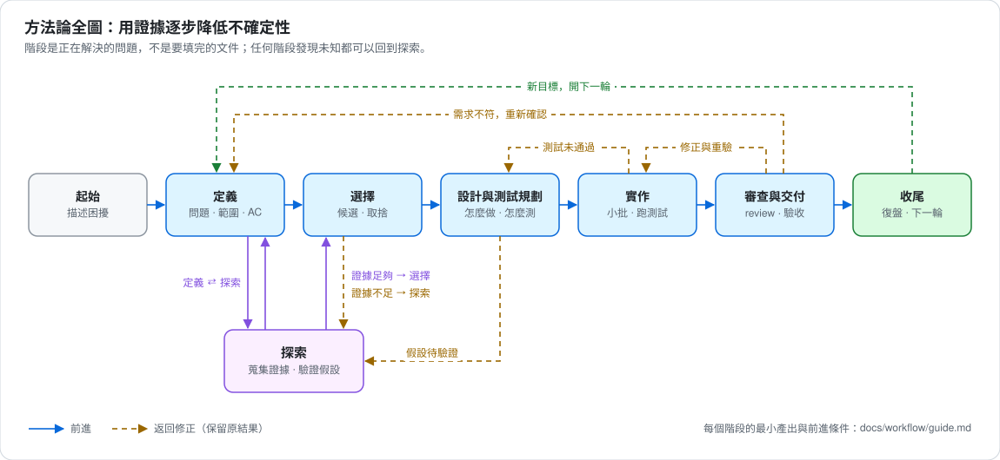
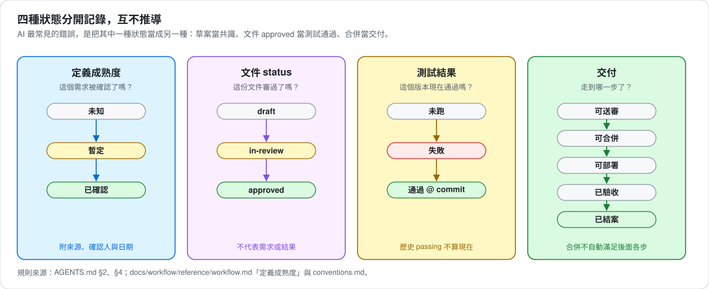
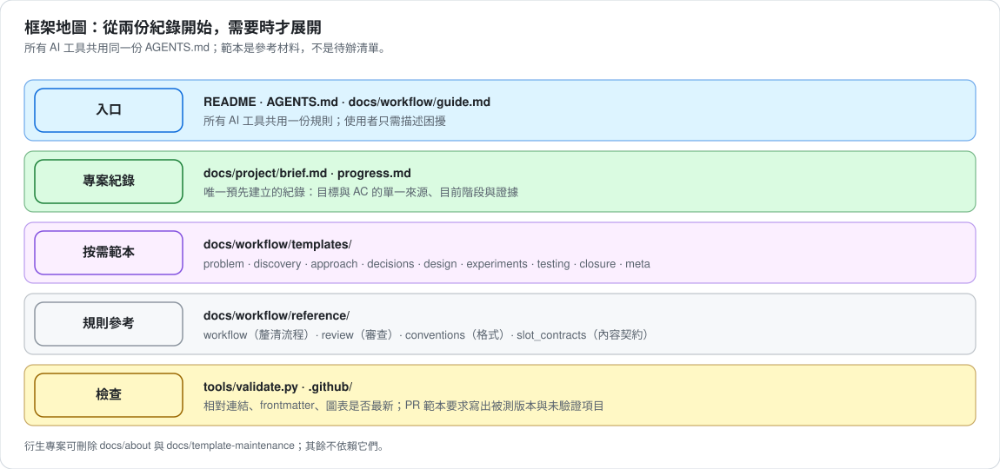
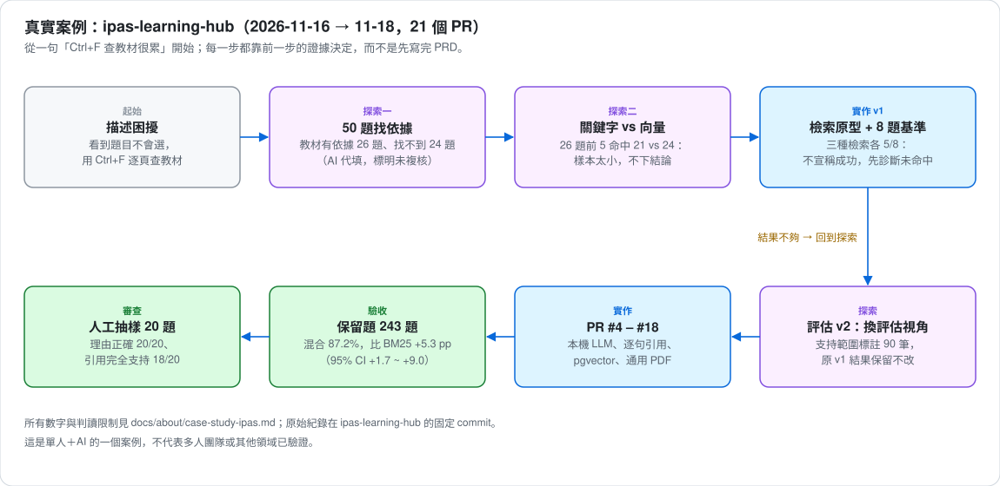

# problem-def-template — 讓 AI 從模糊需求開始，靠證據前進

[English](README.md) | **繁體中文**

只要用一句話描述困擾，AI 就能協助你把它收斂成**已確認的範圍、可驗證的成功條件和可追溯的驗證結果**。這是一套給 AI 輔助開發用的方法論與文件模板。所有 AI 工具共用同一份 [AGENTS.md](AGENTS.md)，專案一開始只需要兩份紀錄。

這套流程用清楚的程式入口和可重跑的檢查，減少人工反覆檢查同一類問題的需要。人負責釐清需求歧義、做設計取捨，以及根據證據決定是否合併。詳見[審查與合併規則](docs/workflow/reference/review.md)與[證據對照](docs/about/EVIDENCE.md)。

<picture>
  <source media="(prefers-color-scheme: dark)" srcset="docs/about/assets/method-loop-zh-TW-dark.svg">
  
</picture>

## 為什麼需要它

AI 在單一對話裡很有效率，但跨越多輪對話、面對模糊需求時，出錯的方式很固定：

| AI 協作的常見失敗 | 這套方法的做法 |
|---|---|
| 使用者隨口提的方案，被當成已確認的需求 | 每項定義標成「未知／暫定／已確認」，並附來源、確認人與日期；沉默與 AI 草案都不算確認 |
| 沒有基準，就先寫下「準確率 90%」 | 禁止編造數字門檻；先量測基準，或寫明確、可重做的人工判準 |
| 結果不好時，悄悄修改判準讓它通過 | 已確認的 AC 要修改，必須先說明影響並取得確認；原結果保留，回到探索 |
| 文件寫完或 approved，就被當成功能完成 | 文件 status、測試結果與交付狀態分開記錄 |
| 很久以前跑過的 passing，被當成現在通過 | 測試結果必須對應被測 commit；未跑、mock、失敗都要寫明 |
| AI 照抄歷史 workaround，或在呼叫端打補丁 | 找出正常入口與負責該行為的模組，在責任所在處修正共用行為，從受影響的入口驗證 |
| 審查者一直抓到同一種問題 | 用 API 和模組邊界讓正確做法容易沿用。可明確判定的規則就轉成可重跑的測試或 CI 檢查 |
| 新的對話忘記先前做到哪裡 | progress 記錄目前階段、證據、未達條件與下一個最小動作，每輪開始與結束都更新 |
| AI 自己 review，就宣稱已經審查 | AI 自查不冒充獨立的真人批准 |

<picture>
  <source media="(prefers-color-scheme: dark)" srcset="docs/about/assets/status-axes-zh-TW-dark.svg">
  
</picture>

## 裡面有什麼

<picture>
  <source media="(prefers-color-scheme: dark)" srcset="docs/about/assets/framework-map-zh-TW-dark.svg">
  
</picture>

| 層 | 讀什麼 | 用途 |
|---|---|---|
| **入口** | [AGENTS.md](AGENTS.md)、[使用指南](docs/workflow/guide.md) | AI 共通規則；階段表列出每一步的最小產出與前進條件 |
| **專案紀錄** | [brief](docs/project/brief.md)、[progress](docs/project/progress.md) | 唯二預先建立的文件：目標與 AC 的單一來源、目前進度與證據 |
| **按需範本** | [範本庫](docs/workflow/templates/README.md) | PRD、探索、方案比較、ADR、設計、實驗、測試、收尾；遇到需要才複製 |
| **規則參考** | [workflow](docs/workflow/reference/workflow.md)、[review](docs/workflow/reference/review.md)、[conventions](docs/workflow/reference/conventions.md)、[slot contracts](docs/workflow/reference/slot_contracts.md) | 釐清流程、審查清單、文件格式、各文件的內容要求 |
| **檢查** | [`tools/validate.py`](tools/validate.py)、[PR 範本](.github/pull_request_template.md) | 連結與錨點、frontmatter、「已確認」須有日期、validation 紀錄的證據欄位、圖表是否最新及 CI init-smoke；PR 必須寫被測版本與未驗證項目 |

## 真實案例：ipas-learning-hub

作者用這套模板，從「看到考題不會選，只能用 Ctrl+F 查教材」這句困擾開始，三天內透過 21 個 PR 做出一個可引用來源的本機 RAG 系統。

<picture>
  <source media="(prefers-color-scheme: dark)" srcset="docs/about/assets/case-ipas-zh-TW-dark.svg">
  
</picture>

| 方法論要求 | 案例中實際發生的事 |
|---|---|
| 沒有基準就不下結論 | 探索二向量 24 題、BM25 21 題，紀錄寫「樣本太小，不足以下結論」 |
| 結果不好時回到探索 | 原型 8 題基準三種方法都是 5/8，沒有宣稱成功，而是做未命中診斷，另建評估 v2，原結果保留 |
| 用沒看過的資料驗收 | 243 題保留測試集：混合檢索 87.2%，比 BM25 多 5.3 個百分點（95% CI +1.7～+9.0） |
| 選項答對不等於理由正確 | 人工抽樣 20 題：理由正確 20/20、引用完全支持 18/20；寫明判讀者是作者本人 |

完整過程、實際用到的範本，以及沒做好的地方，見[案例研究](docs/about/case-study-ipas.md)。以上數字是 commit `5891f4c` 的快照；ipas-learning-hub 之後繼續開發（截至 2026-11-27 共 52 個 PR，包含 RAG 可觀測介面），現況見其 [README](https://github.com/Cheryl33990/ipas-learning-hub#readme)。

## 開始使用

**新專案**：在 GitHub 按 **Use this template**，然後把下面這段貼給你的 AI 工具（Claude Code、Codex、Cursor 等）：

> 請先讀 AGENTS.md、docs/workflow/guide.md 與 docs/project 的 brief、progress。我目前的困擾是……，還不知道範圍與成功標準。請用白話回述情境，每輪問少量關鍵問題，再提出有理由的候選範圍與成功條件。未知保持未知，資訊不足時先提限量探索。

**既有專案**：在工作分支加入 `docs/workflow/`，把需要的規則整合進原本的 AGENTS.md，用 progress 記錄路徑對照。不要覆蓋既有的 README、CI 或程式目錄。詳見[使用指南](docs/workflow/guide.md) §1。

初始化後可以刪除 `docs/about/`、`docs/template-maintenance/` 和 `tools/render_diagrams.py`，它們只屬於模板本身。

## 設計原則

- **證據優先於狀態。** 文件寫完、status 是 approved、PR 合併，都不等於問題解決了。
- **未知是合法的答案。** 不知道就標未知，先提出最小的探索；不替使用者編造需求或門檻。
- **只在需要時建文件。** 從兩份紀錄開始；範本是參考材料，不是待辦清單。
- **一份規則給所有 AI 工具。** 不維護工具專屬的規則副本。
- **規則要能被檢查。** 能用程式檢查的（連結、格式、圖表）就交給 CI。

## 目錄

```text
AGENTS.md                 所有 AI 工具共用的規則入口
docs/project/             專案紀錄：brief、progress（衍生專案的實際內容）
docs/workflow/guide.md    使用指南與方法論導航（唯一使用入口）
docs/workflow/reference/  詳細規則：流程、審查、格式、內容契約
docs/workflow/templates/  按需複製的空白範本
docs/workflow/examples/   教學用合成示例
docs/about/               模板介紹：案例研究、證據、狀態、圖表
docs/template-maintenance/ 模板自身的變更歷史與維護紀錄
tools/                    validate.py（文件檢查）、render_diagrams.py（產生圖表）
src/、tests/              衍生專案的程式與測試位置（目前為空）
```

## 驗證

### 模板內建檢查

```sh
python tools/validate.py   # Python 3.9+，沒有第三方套件
python -m unittest discover -s tools -p "test_*.py"   # 檢查工具的測試
```

驗證器檢查相對連結、錨點、frontmatter、確認日期、驗證紀錄的必要證據欄位，以及圖表是否最新。證據檢查涵蓋欄位是否存在及格式。CI 在 PR 與推送到 main 時執行驗證器和它的單元測試，並由 `init-smoke` 檢查移除模板專屬材料後的初始化副本。詳見 [CI 工作流程](.github/workflows/validate.yml)。

### 衍生專案的應用程式驗證

先從正常入口建立可重跑的回歸測試。若輸入組合或事件順序仍有重要風險，先定義必須成立的規則，再選能抓到違規的測法。可用屬性測試探索生成的輸入、Bombadil 探索 UI 操作順序、TLA+ 檢查交錯狀態的模型，或用 Lean 證明有精確規格的性質。模板提供選用條件與證據指引，採用的檢查由各專案自行設定。詳見[測試策略](docs/workflow/templates/testing/test_strategy.md#property-and-formal-verification)。

目前狀態與公開檢查清單見 [STATUS](docs/about/STATUS.md)；模板維護歷史見[維護入口](docs/template-maintenance/README.md)。

## 授權

[MIT](LICENSE)
