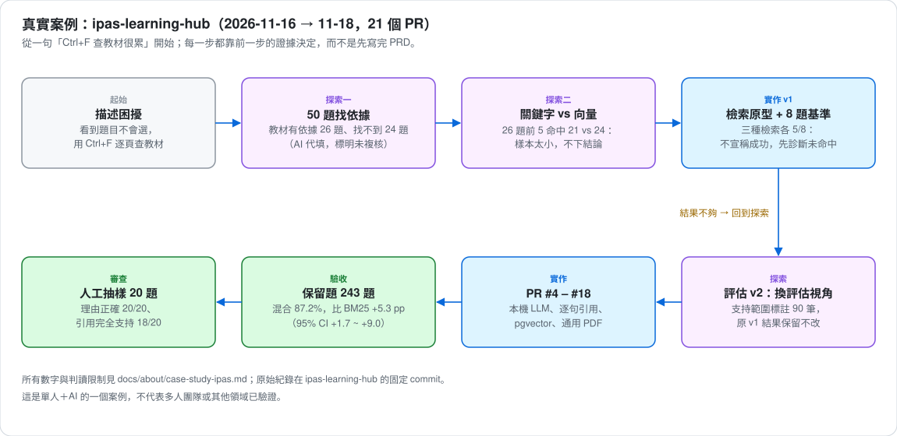

# 案例研究：ipas-learning-hub

本模板第一個、也是目前唯一一個真實使用案例。作者一人搭配 AI 編碼工具（commit 紀錄中為 Claude Code），從一句模糊的困擾開始，三天內做出一個可引用來源的本機 RAG 系統，共 21 個 PR。

以下所有連結都固定在 ipas-learning-hub 的 commit [`5891f4c`](https://github.com/Cheryl33990/ipas-learning-hub/tree/5891f4c)，之後的修改不影響這裡的引用。

<picture>
  <source media="(prefers-color-scheme: dark)" srcset="assets/case-ipas-zh-TW-dark.svg">
  
</picture>

## 起點：只有一句困擾

使用者原話（2026-11-16，記在 [brief](https://github.com/Cheryl33990/ipas-learning-hub/blob/5891f4c/docs/internal/project/brief.md)）：

> 我看到題目不知道要怎麼選，拿關鍵字去 CTRL F 查教材，還需要自己判定是哪邊錯。所以我會希望有可以知道出處，還有結合 web search 或是公開確認的資料，讓我能更加系統化學習。

使用者同時提出「模擬考古題系統、教材向量化、串接 LLM」這個方案。依照 [AGENTS.md](../../AGENTS.md) §2，AI 把它記為「最初提出的方案（尚未成為已確認方案）」，沒有直接開工。

## 每一步怎麼前進

| 階段 | 做了什麼 | 結果 | 方法論在這裡起的作用 |
|---|---|---|---|
| 起始 → 定義 | 把困擾拆成三個可檢驗的假設：用詞不同導致搜不到、向量檢索較好、部分題目教材沒有依據 | 假設 H-01～H-03，逐項標「暫定」 | 方案不等於需求；沒有基準就不定數字門檻 |
| 探索一 | 一份 50 題試題，找出每題在教材中的依據頁 | 有依據 26 題、找不到 24 題（[紀錄表](https://github.com/Cheryl33990/ipas-learning-hub/blob/5891f4c/docs/internal/project/discovery/exploration-1-record.md)） | 使用者中途改成由 AI 代填依據，紀錄寫明「這是 AI 判斷，未複核」，也寫出這個改變讓分類的意義跟著改變 |
| 探索二 | 26 題比較關鍵字與向量檢索 | 前 5 筆命中：向量 24、BM25 21（[結果](https://github.com/Cheryl33990/ipas-learning-hub/blob/5891f4c/docs/internal/project/discovery/exploration-2-results.md)） | 結論寫「差 3 題，樣本太小，不足以下結論」，沒有拿來宣稱向量較好 |
| 實作 v1 | 雙科教材、BM25／向量／混合三種檢索、Docker 原型（PR #3） | 8 題基準三種方法都是 5/8 | 結果不夠好時沒有改判準讓它通過，而是做[未命中診斷](https://github.com/Cheryl33990/ipas-learning-hub/blob/5891f4c/docs/internal/project/validation/2026-11-16-retrieval-miss-analysis.md) |
| 返回探索 | 發現「前五沒有標準頁」不等於「沒有支持內容」，另建評估 v2 | 90 筆片段標註支持範圍（[v2](https://github.com/Cheryl33990/ipas-learning-hub/blob/5891f4c/docs/internal/project/validation/2026-11-16-retrieval-support-v2.md)） | 新評估另開一份，原 v1 結果保留不改；標註寫明「AI 標註，人工待審」 |
| 實作 | PR #4–#18：本機 LLM、逐句引用與檢查、pgvector、通用 PDF、知識庫隔離 | 每個 PR 記錄被測 commit、測試數量與未驗證項目 | progress 的「目前階段與前進判斷」每輪更新；可送審、可合併、已驗收分開寫 |
| 驗收 | 243 題保留測試集（開發期間沒用過的試卷），三種檢索各跑一次 | 混合 87.2%、BM25 81.9%；混合比 BM25 多 5.3 個百分點，成對 bootstrap 95% CI +1.7～+9.0（[評估](https://github.com/Cheryl33990/ipas-learning-hub/blob/5891f4c/docs/evaluation.md)） | 向量對 BM25 的區間含 0，報告寫「不能說較好」；限制寫明單一模型、單次執行 |
| 審查 | 從答對題中隨機抽 20 題，人工判讀理由與引用 | 理由正確 20/20；引用完全支持 18/20（Wilson 95% CI 70%～97%） | 選項答對不等於理由與引用正確；寫明判讀者是作者本人，不是獨立第三方 |

## 實際用到哪些範本

依 ipas-learning-hub 的目錄判斷。沒有獨立建檔的，內容寫在 brief 或 progress 裡（這正是「按需建檔」的設計）。

| 類別 | 是否建獨立文件 | 說明 |
|---|---|---|
| brief、progress | 是 | 從頭用到尾 |
| design | 是（3 份） | 實作前先寫測法，例如[知識庫隔離設計](https://github.com/Cheryl33990/ipas-learning-hub/blob/5891f4c/docs/internal/project/design/document_knowledge_bases.md) |
| discovery | 是（2 份） | 探索一、探索二 |
| validation | 是（13 份） | 每次驗證一份，記被測版本與限制 |
| problem／PRD、approach、decisions（ADR）、experiments、testing、closure、meta | 否 | 選擇與取捨直接寫在 brief；這個規模不需要 |

結論：小型單人專案只需要 brief、progress、design、discovery、validation。其他範本留給多人協作或需要獨立簽核的情境，[使用指南](../workflow/guide.md)的「什麼時候才新增文件」已經寫明觸發條件。

## 沒做好的地方與已做的修正

- **progress 太長**：ipas 的 progress 累積到約 196 KB、984 行，新的接手者很難找到目前狀態，違反「10 分鐘接手」的目標。已在模板加上規則：progress 只保留目前狀態，超過約 150 行就把舊紀錄移到 `docs/project/log/YYYY-MM.md`（[使用指南](../workflow/guide.md) §6、[progress](../project/progress.md)）。
- **探索一改由 AI 代填**：省下使用者時間，但讓「使用者實際卡在哪裡」的量測失效。紀錄有寫明這一點，不過下一個專案應該在改變方法前，先評估會不會影響要回答的問題。
- **評估數字只有一個模型、一個領域**：這是案例本身的限制，不能推論到其他領域或多人團隊。

## 這個案例能證明什麼、不能證明什麼

| 能支持的說法 | 不能支持的說法 |
|---|---|
| 一個人用 AI 工具時，這套規則能讓模糊需求一步步收斂成可量測的結果 | 對多人團隊同樣有效 |
| AI 產出的草案、判讀與標註，都被清楚標成「暫定」或「未複核」 | 這套方法比其他方法更快（沒有對照組） |
| 結果不好時是回到探索，而不是修改判準 | 每個專案都需要這麼完整的紀錄 |
