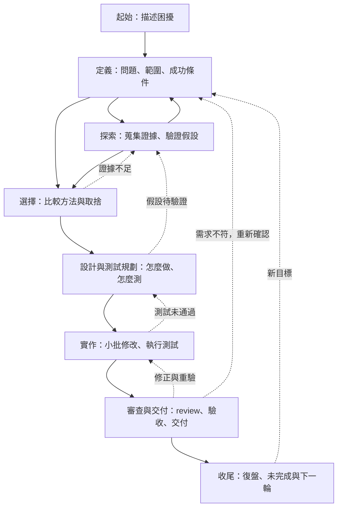

# 從一個問題開始使用模板

本頁是唯一使用入口。你只需用自然語言描述困擾，AI 協助釐清問題、範圍與成功條件。未知就保留未知，沒有資料時先做小型探索。

## 1．建立或整合專案

**新 repo**：在 GitHub 有 Use this template 時，用它建立新 repo；沒有此入口也可複製檔案到新 repo。衍生專案是獨立副本，不會自動取得模板更新。
初始只需 README、AGENTS、docs/project 兩份紀錄與本工作指南。src、tests 是空位置標記，沒有 Python 或其他語言依賴；開始實作時依框架建立實際結構，非程式專案可移除。

**既有 repo**：在工作分支加入 docs/workflow，並按需要加入 docs/project。不要覆蓋既有 README、AGENTS、CI、ADR 或程式目錄；將需要的規則整合進原 AGENTS，於 progress 記路徑對照。已有同用途文件就沿用，不再建立副本。

**移除模板維護材料**：docs/template-maintenance 只記模板的歷史、盤點與試跑計畫，不是新專案的成果。新專案可移除整個目錄；同時把根 README 改成自己的介紹，刪掉模板維護入口。指南、規則和空白範本不依賴該目錄。教學 examples 可選擇保留，不是專案待辦。

## 2．先用兩份文件開始

- [brief](../project/brief.md)：使用者原話、事實與假設、範圍、成功條件和確認紀錄。
- [progress](../project/progress.md)：目前做什麼、實際路徑、阻礙與下一步。

AI 先利用已有資料回述情境，每輪問 1–3 個最關鍵問題，再提候選方向與取捨。你可以接受、修正或回答不知道。
定義標未知／暫定／已確認。沒有基準時先量測，不編造門檻；成功條件也可採明確人工判準。
正式實作採用已確認範圍與 AC。探索可只先確認疑問、操作／資料、時間資源邊界及完成條件，不要求先有產品 AC。

## 方法論導航：目前在哪裡、下一步是什麼

方法論的核心是「用證據逐步降低不確定性」。階段描述正在解決的問題，文件只是保存成果的方式；**按需建檔不等於略過必要思考與驗證**。以下全圖與階段表是導航的主來源，詳細協作規則見 [workflow](reference/workflow.md)。

### 方法論全圖

純文字讀法：起始 → 定義 ↔ 探索 → 選擇 → 設計與測試規劃 → 實作 → 審查與交付 → 收尾。證據足夠時，定義可直接進選擇；任何階段發現未知，都可返回探索。圖不是一次走完的瀑布流程。

### 各步驟的最小產出與前進條件

以下條件針對「本輪任務」，不是要求整個專案全部確定。AC 是驗收條件，即事前約定怎樣算成功。簡單工作可在同一輪完成多步，但仍要留下適用證據。

| 階段 | 最小產出：先記在哪裡 | 什麼時候新增文件 | 何時可前進／否則怎麼辦 |
|---|---|---|---|
| 起始 | brief：使用者原話、具體情境、事實與未知 | 不新增；先用 brief、progress | 能說清要改善的困擾或下一個釐清問題，就進定義；資訊不足由 AI 提少量關鍵問題 |
| 定義 | brief：本輪問題、做與不做、約束、候選 AC，逐項標成熟度與確認來源 | 需求太長、多角色分工或需獨立維護時拆 PRD／AC | 本輪範圍與 AC 已確認可進選擇；缺基準時只確認探索疑問、操作邊界、資源上限及完成條件，轉探索，不強造產品 AC |
| 探索 | brief 或 progress：疑問、來源／方法、觀察、限制、結論與下一個決定 | 多來源分析需重現時建 discovery；假設需受控比較時建 EXP | 證據足以支持一個決定，返回定義或進選擇；無結論也是結果，記錄後決定限量再探、縮小範圍或停止，不自動標成功 |
| 選擇 | brief：合理候選（含維持現況）、取捨、選擇理由與殘餘風險 | 比較繁複時建 approach；重大或難回頭的決定建 ADR | 本輪方案及必要重大決策已確認，關鍵未知已解答或風險明確接受，進設計；只有一個合理方案也須說明理由 |
| 設計與測試規劃 | brief 或 progress：行為／介面、重要失敗情境、每條適用 AC 的測法與判準、回復方式 | 多介面或多人協作建 design；案例／資料需獨立管理建 testing | 本輪範圍、AC、必要決策已確認，知道怎麼做與怎麼測，才進正式實作；方法仍不確定先探索 |
| 實作 | 程式／測試目錄：小批變更；progress：被測版本、步驟、結果與限制 | 結果太長或多次執行需比較時建 validation；程式測試放原框架目錄 | 有可 review 的 diff 與證據即可送審；測試失敗或未跑必須揭露並列阻礙，不能當成可交付；修正後重驗 |
| 審查與交付 | PR 或 progress：review 發現及處理、AC 對照、交付版本、確認紀錄；有部署則記部署驗證 | 多批驗收或正式交接需獨立證據時建 validation／交接紀錄 | 阻擋交付的問題已處理，本輪適用 AC 通過，必要審查與交付授權具備才交付；失敗返回修正或經確認調整範圍，保留原結果 |
| 收尾 | progress：完成／未完成、接受風險、復盤、負責人與下一步 | 完整結案或多人交接需獨立簽核時建 closure | 負責人確認本輪結果與後續責任，才結束本輪；新目標另開一輪。探索後決定停止可記為停止及理由，不冒充產品驗收通過 |

「可送審」「可合併」「可部署」「已驗收」「已結案」分開記錄，PR 合併不自動滿足後面條件。不適用的步驟／產出寫 N/A、理由與依據；缺資料或沒做不能填 N/A。

### 如何知道目前走到哪一步

打開 [progress](../project/progress.md) 的「目前階段與前進判斷」。AI 在每輪開始與結束，以實際成果核對上表，更新目前階段、證據、缺口與下一步；**不能從資料夾存在、文件數量或 approved 狀態推算進度**。

若同時做多件事，逐個任務標階段，例如「功能 A：實作；功能 B：探索」，不把整個專案硬標成同一階段。已有明確授權且條件達成的可逆工作可繼續，不要求每跨一階段都再詢問。

例如（教學情境，不是本專案成果）：只知道「查資料很花時間」時，先在定義階段記未知；沒有基準，就提出限量觀察任務轉探索。觀察完成後回到定義，提出有依據的候選 AC，經確認才選方案。整段可以只用 brief／progress，不需先新增 PRD 或實驗目錄。

## 3．什麼時候才新增文件

[範本庫](templates/README.md)提供可複製材料，**不要在範本原檔填你的專案內容，也不要一次複製全部**。

| 真的遇到的需求 | 建議新增位置（尚未預建） | 使用範本 |
|---|---|---|
| brief 已太長或多角色協作 | docs/project/problem/ | templates/problem |
| 需要查資料或分析 | docs/project/discovery/ | templates/discovery |
| 需要比較候選方案 | docs/project/approach/ | templates/approach |
| 重大或難以回頭的選擇 | docs/project/decisions/ADR-NNN-title.md | templates/decisions |
| 已確認方案需要詳細介面／設計 | docs/project/design/ | templates/design |
| 可證偽假設需要實驗 | docs/project/experiments/EXP-NNN-title/ | templates/experiments |
| 測法或案例已超過 brief 可容納程度 | docs/project/testing/ | templates/testing |
| 要保存本次測試證據 | docs/project/validation/YYYY-MM-DD-title.md | templates/testing/validation |
| 準備結案，需完整檢查與復盤 | docs/project/closure/ | templates/closure |
| 多來源、多假設或追溯關係變複雜 | docs/project/meta/ | templates/meta |

小型任務的比較、判準、結果與復盤可直接放 brief／progress；不強制獨立建檔。
需要拆分時，將原段落改成摘要＋新文件連結。原本已確認的 AC 編號和證據關係保留。

## 4．複製範本後必做的整理

1. 只取本輪需要的檔案，放到上表目的位置；改成實際名稱，例如 ADR-001-storage.md 或 AC-01.md。
2. 將 frontmatter 改 draft，更新標題、日期與內容；未使用欄位可寫 N/A 與理由。
3. **重新定位連結**：範本庫的相對連結用來瀏覽範本，不會因複製自動變成專案連結。把 Markdown、正文及 YAML 中的路徑都改到真實文件；尚未建立的依賴寫待建立，或連到 brief 的對應段落。
4. 在 progress 登記實際主來源；檢查新文件每個連結能開啟，且指向專案證據而非空白範本。
5. 契約只檢查本輪適用內容，不要求所有範本 TODO 清空。未知與不適用分開記。

例如 AC 規格複製到 docs/project/testing/acceptance_tests/AC-01.md；實際驗證紀錄放 docs/project/validation，程式測試則放 tests。三者互相連結，但用途不同。

## 5．每天怎麼進行

讀 brief、progress 及本輪相關文件 → 選一個小目標 → 在工作分支探索或實作 → 保存證據 → 開 PR → review → 合併後更新下一步。
Issue 可追待辦，PR 保存具體變更；小任務不強制重複填兩份。
實作前先定測法；資料、工具、環境與當次版本記進結果。未跑或失敗要明寫。測試命令依實際語言與框架設定，本模板沒有預裝工具或 CI。

## 6．驗證、Review 與收尾

- 假設驗證：方法是否值得繼續？記探索／實驗結果。
- 測試：實作是否符合已定義行為？測成功、失敗與重要邊界。
- Review：讀實際 diff 與證據，找遺漏、錯誤與剩餘風險；詳見 [review](reference/review.md)。
- 驗收：本輪已確認的 AC 是否達成？文件 approved 不等於測試通過。
- 結案：保存未完成與接受風險，復盤後才簽署；合併不代表部署或整個專案完成。

每次結束更新 progress；不用等專案結案。對已接受需求或門檻的變更先說明影響並確認，不能事後改到「通過」。

## 7．給 AI 的起手指令

> 請先讀 AGENTS.md、docs/workflow/guide.md 與 docs/project 的 brief、progress。我目前的困擾是……，還不知道範圍與成功標準。請利用已有資料，用白話回述情境，每輪問少量關鍵問題，再提出有理由的候選範圍與成功條件。未知保持未知，資訊不足時先提限量探索。不預建所有階段文件，依需要從範本庫取用。已有明確授權的可逆工作持續完成，重大範圍變更提出供我確認。

接手時請 AI 先讀 progress 與相關證據，說明本輪所在階段、未達的前進條件與下一個最小動作；review 時要求依 reference/review.md 檢查實際 diff、被測版本與限制。

## 8．深入參考與版本更新

[workflow](reference/workflow.md)保存完整釐清流程及階段條件；[conventions](reference/conventions.md)定義文件狀態；[slot contracts](reference/slot_contracts.md)規範需要展開的文件內容。日常從本頁和兩份專案紀錄開始即可。
記下採用的模板 commit；之後用獨立 PR 挑選方法改進，不整包覆蓋既有專案紀錄或程式。此流程尚未通過真實案例可用性驗證。
